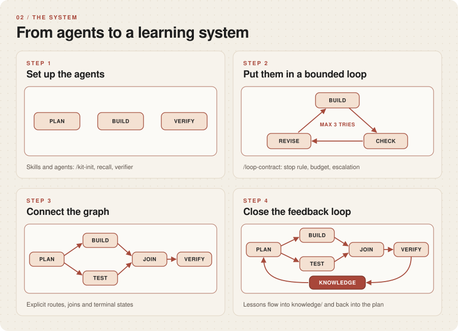
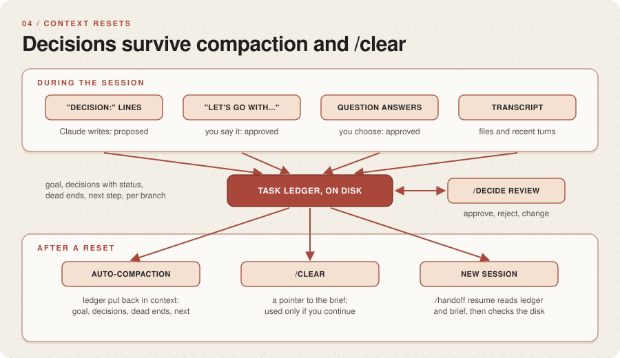
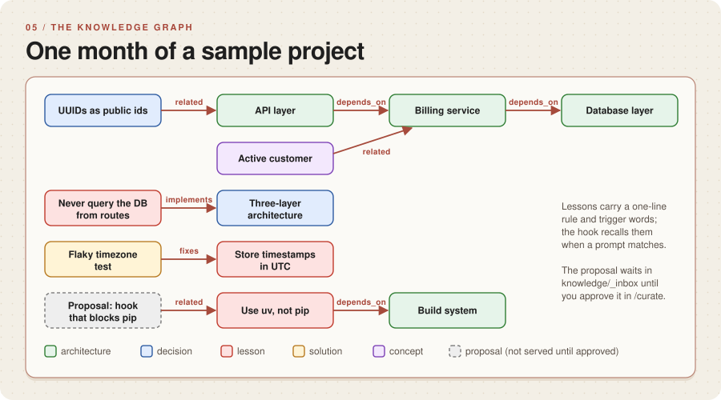

# Claude project kit

[](https://github.com/ENIGMA-KUN/claude-project-kit/actions/workflows/test.yml)
[](LICENSE)


A plug-and-play Claude Code setup that adapts to any project and gets better the more you use it.

Drop it into a new or existing repository, run `/kit-init`, and Claude starts every session knowing the project's architecture, its decisions and the mistakes it should not repeat. When you correct Claude, the correction becomes a reviewed lesson in a small knowledge graph, and the next session recalls it on its own. Decisions and the current goal survive compaction and `/clear`. Once a week, `/curate` turns the friction it logged into concrete improvements, and nothing changes until you approve it.

```
/plugin install project-kit --marketplace ENIGMA-KUN/claude-project-kit
/project-kit:adopt
```

<p align="center"></p>

## Watch the explainer (3 minutes)

Narrated walkthrough with every diagram animated: the problem, setup, the loops, context resets and the knowledge graph.

https://github.com/user-attachments/assets/90834dc6-7b6e-4c86-a415-e7bcba96feb1

Download: [MP4, 720p, 6 MB](docs/media/claude-project-kit-explainer.mp4)

<p align="center"></p>

## Contents

- [Watch the explainer](#watch-the-explainer-3-minutes)
- [Quick start](#quick-start)
- [What you get](#what-you-get)
- [Situations where it helps](#situations-where-it-helps)
- [A week with the kit](#a-week-with-the-kit)
- [How it works](#how-it-works)
- [Context resets and decisions](#context-resets-and-decisions)
- [Staying current](#staying-current)
- [The knowledge graph](#the-knowledge-graph)
- [Safety model](#safety-model)
- [How it compares](#how-it-compares)
- [FAQ](#faq)
- [Contributing](#contributing)
- [Credits](#credits)

## Quick start

<p align="center"></p>

Requirements: [Claude Code](https://code.claude.com) 2.1.275 or later, git, and Python 3.8 or newer on PATH. Nothing else to install; the engine is standard-library Python.

### Option A: plugin (recommended)

Inside Claude Code, run:

```
/plugin install project-kit --marketplace ENIGMA-KUN/claude-project-kit
```

Then, in any project you want to set up:

```
/project-kit:adopt
```

`adopt` copies the kit into the project and runs `/kit-init` for you. On older Claude Code versions, add the marketplace first with `/plugin marketplace add ENIGMA-KUN/claude-project-kit`, then `/plugin install project-kit@claude-project-kit`.

### Option B: clone and run the installer

```bash
git clone https://github.com/ENIGMA-KUN/claude-project-kit.git
cd claude-project-kit
```

Windows (PowerShell):

```powershell
powershell -ExecutionPolicy Bypass -File .\install.ps1 -Target C:\path\to\your-project
```

macOS or Linux:

```bash
./install.sh /path/to/your-project
```

Add `-Global` (or `--global`) to also install a personal `/kit-adopt` command that works in every project without the plugin. `-ExecutionPolicy Bypass` only matters if script execution is disabled on your machine, and applies to that one command.

### Adapt it to the project

With option B, or to re-run later, open Claude Code in the project folder and run one of:

| Your project | Command |
|--------------|---------|
| Existing codebase | `/kit-init` |
| Empty or nearly empty folder | `/kit-init --new` |
| Kit already installed, or the project changed a lot | `/kit-init --refresh` |

`/kit-init` reads the code first, asks at most four questions about things the code cannot tell it, then writes a short `CLAUDE.md`, seeds the knowledge graph and records your real test and lint commands. Restart Claude Code afterwards so the project hooks load.

The installer never overwrites your files. If you already have a `CLAUDE.md` or `.claude/settings.json`, the kit's version is parked in `.claude/kit/incoming/` and `/kit-init` merges it with you.

## What you get

| Piece | What it does |
|-------|--------------|
| `/kit-init` | The adaptive init prompt: scans, interviews, writes `CLAUDE.md`, seeds knowledge, verifies commands |
| `knowledge/` | A graph of Markdown nodes (architecture, decisions, lessons, solutions, concepts, procedures) with typed links, sources and review dates |
| Hooks | Recall matching knowledge on each prompt, log corrections and failures, stop the third identical failure, block destructive commands and secrets |
| `/learn` | Turns a correction or a hard-won fix into a node, after you confirm it |
| `/reflect` | End-of-session retro: three to five items worth keeping |
| `/curate` | Weekly meta loop: evidence-backed proposals, constitution check, you approve |
| `/loop-contract` | Goal, budget, stop rule and verification written down before long or risky work |
| Task ledger | Per-branch working memory on disk: goal, decisions with status, dead ends, next step. Comes back after compaction and `/clear` |
| `/decide` | Save, change, review and approve decisions; promote lasting ones to the knowledge graph |
| `/experiment` | Research-integrity guard: protected evaluation data and metric code, a run log with seeds and data fingerprints, results that trace to logged runs |
| `/second-opinion` | Optional review of a change by a different model (Codex CLI, Gemini CLI, another Claude model); off by default |
| `/upkeep` | Kit updates, and a watchlist of the outside tools the project uses: new releases, archived or relicensed projects, and checked alternatives |
| `/handoff` | Save state before stopping; resume tomorrow with the claims re-checked |
| `/audit` | Quarterly clean-up of instruction debt and context budget |
| `recall` | Lets Claude search the graph on its own when a task touches known ground |
| `verifier` agent | Fresh-context review that accepts work only on evidence |
| `curator` agent | Mines the friction log and drafts proposals, writing only to the inbox |
| `constitution.md` | Rules the learning loops can never change on their own |
| `kg.py` | The engine: build, validate, search, drift and staleness checks, friction stats, health check |

## Situations where it helps

| Situation | What you run | What you get |
|-----------|--------------|--------------|
| You inherit a large or legacy codebase | `/kit-init` | Architecture nodes for each module, the real commands, and the traps you mention, ready for every later session and for teammates |
| You start a project from an empty folder | `/kit-init --new` | Your stack choices recorded as decisions with reasons, and a tiny `CLAUDE.md` that grows from real corrections instead of guesses |
| Claude keeps making the same mistake (pip instead of uv, wrong test folder, editing generated files) | `/learn` once | A lesson with trigger words; the hook brings it back whenever the trigger shows up. If it still recurs, `/curate` proposes a hook or test instead |
| A bug you fixed months ago comes back | `recall` (automatic) | The old `solutions/` node, with the root cause and the edge cases, shows up when the same error text appears |
| ML or research repo with notebooks and experiments | `/kit-init`, then `/experiment setup` | Evaluation data and metric code that cannot change without your approval, every run logged with seed and data fingerprints, and reported numbers that must trace to a logged run, failed runs included |
| A high-stakes change where you want a check that does not share one model's blind spots | `/second-opinion` | A different model reviews the diff, the ledger and the run log and returns ACCEPT, REJECT or ESCALATE; disagreements come to you |
| A crawler, parser or SDK the project depends on gets archived, relicensed or abandoned | `/upkeep` (the weekly check flags it) | The change with evidence, the listed alternatives checked for health, new candidates compared on maintenance and license, and the choice recorded as a decision |
| A new kit version ships | nothing, then `/upkeep` | A one-time note at session start, the changelog since your version, and an update that backs up every kit file it replaces |
| A long refactor or migration you want to run with little supervision | `/loop-contract migrate X to Y` | A written contract with allowed files, verification commands and an attempt budget, then an independent verifier verdict with evidence |
| You stop mid-task and come back next week | `/handoff`, later `/handoff resume` | A resume that re-checks what was actually done instead of trusting the old summary |
| Auto-compaction hits in the middle of a long task | nothing | The goal, approved decisions, dead ends and next step are put back into context right after compaction, so Claude does not reopen settled questions or retry what failed |
| You run `/clear` to free context but keep working on the same branch | `/handoff resume` | A brief built from the transcript (original and latest request, files touched, recent turns) plus the ledger |
| You want to sign off on Claude's choices before it builds on them | `/decide review` | Claude's proposed decisions listed with their reasons; approve, reject or change each one, and the history is kept |
| Team repository | commit `knowledge/` | Shared, reviewable project memory in pull requests; each person's friction log stays on their machine |
| Non-code work: a paper, docs site, research notes, data analysis | `/kit-init` in that folder | Concepts and decisions for the domain, and `/loop-contract` with a checklist as the verification step |
| You use Claude Code in many repositories | `/kit-adopt` in each | One setup everywhere. Improvements a project discovers for the kit itself go to `FEEDBACK.md`, and re-running the installer upgrades every project |

## A week with the kit

A small FastAPI service, one developer.

- Monday. `/kit-init` finds `uv`, `pytest`, `ruff` and an Alembic folder, asks two questions, writes a 60-line `CLAUDE.md` and seven nodes (four architecture, two decisions, one concept).
- Tuesday. Claude runs `pip install` and breaks the venv. You say "no, we use uv". The prompt hook logs the correction and Claude offers `/learn`; you accept. The lesson gets the rule "Run uv add / uv run; never pip install" and triggers `pip install`, `ModuleNotFoundError`.
- Wednesday. New session. You ask for a new dependency. The hook matches "dependency, install" and puts the uv lesson in context before Claude acts.
- Thursday. A test fails three times in a row with the same import error. The failure hook tells Claude the loop budget is spent; it stops retrying, finds the circular import, and you `/learn` the fix as a solution node.
- Friday. `/reflect` suggests two more items; you keep one.
- The next Monday. The session-start note says the meta loop is due. `/curate` shows that the uv lesson was injected twice and the failure did not recur, and that the circular-import pattern appeared in two sessions. It proposes an import-linter rule in CI. You approve; it adds the rule and runs the check to show it passes.

## How it works

<p align="center"></p>

The kit follows the ideas in loop and graph engineering: start with the smallest structure that works, give every loop a stop rule and a budget, make routes explicit when there are branches, and close the loop by feeding what was learned back into the next plan.

<p align="center"></p>

Three design choices keep it from turning into a pile of rules:

- Facts are retrieved, not always loaded. Lessons and decisions live in the graph and reach the context only when a prompt matches them, so `CLAUDE.md` can stay under 150 lines.
- The strongest control wins. A mistake that recurs after its lesson was recalled gets a test, lint rule or hook, because prose is the one control that has to be remembered.
- Nothing promotes itself. Proposals carry evidence and wait for you. A proposal seen three times must be decided, so the loop cannot stay open.

Hook events, retrieval settings, signal format and the proposal lifecycle are in [docs/how-it-works.md](docs/how-it-works.md).

## Context resets and decisions

<p align="center"></p>

Long sessions lose context twice: when Claude Code compacts the conversation, and when you `/clear` it yourself. Git keeps the files, but not the current goal, what was decided and why, or what was already tried and failed. A fresh context tends to reopen settled questions and retry the obvious approach that already broke.

The kit keeps a task ledger per git branch in `.claude/kit/ledger/`, filled mostly by hooks:

| Source | Recorded as |
|--------|-------------|
| Claude writes `Decision: key the limiter on the API key, because agents share one IP` | proposed decision with its reason |
| Claude writes `Dead end: ...` or `Next: ...` | dead end, next step |
| You write "let's go with the sliding window" or "use uv instead of pip" | approved decision |
| You answer an AskUserQuestion prompt | approved decision |
| PreCompact, Stop (every 2 minutes at most) and SessionEnd | a resume brief built from the transcript: original and latest request, files touched, recent turns, within 8,000 characters |

After auto-compaction, the open part of the ledger goes straight back into context, marked as more reliable than the summary. After `/clear`, Claude gets a one-line pointer and uses the brief only if you continue that task. A new session on the same branch gets the same pointer; `/handoff resume` loads everything and checks it against the files on disk.

`/decide` is the manual side: record a decision on purpose, `review` to approve or reject Claude's proposals in one batch, `change D2 "..."` to replace a decision while keeping the old one as superseded, and `promote D2` to turn a task decision into a permanent knowledge node. The `verifier` agent rejects work that contradicts an approved decision or retries a recorded dead end.

## Staying current

Two things age without anyone noticing: the kit, and the outside tools a project leans on. `upkeep.py` checks both, at most once a week, in a background process that adds nothing to session start. Anything new is reported once at the next session start, and `/upkeep` handles it with you.

| What | Checked against | Flagged when |
|------|-----------------|--------------|
| The kit | the latest release of [ENIGMA-KUN/claude-project-kit](https://github.com/ENIGMA-KUN/claude-project-kit), or your fork | a newer version exists |
| Each tool in `.claude/kit/watchlist.json` | its GitHub repository, plus PyPI, npm or Hugging Face when given | archived, deprecated, renamed, license changed, no commits for 270 days, or a release newer than the version you pin |
| The alternatives listed for a flagged tool | the same checks | so a dead project is never offered as the replacement |

```bash
python .claude/kit/upkeep.py check                  # kit version and watchlist report
python .claude/kit/upkeep.py update                 # changelog since your version, then install with a backup
python .claude/kit/upkeep.py watch add crawl4ai --github unclecode/crawl4ai --pypi crawl4ai --alt firecrawl/firecrawl
python .claude/kit/upkeep.py watch preset research  # crawlers, PDF parsers, agent loops, model runtimes, a benchmark
python .claude/kit/upkeep.py probe firecrawl/firecrawl apify/crawlee   # compare candidates
```

Kit updates install only when you run or approve them. Set `upkeep.mode` to `auto` to have minor and patch releases installed in the background; a new major version always waits for you. `off` stops the background check. When a watched tool is flagged, `/upkeep` searches for maintained replacements, compares them with `probe`, checks what the project actually uses, and leaves the switch to you. Details in [docs/how-it-works.md](docs/how-it-works.md#upkeep).

## The knowledge graph

One concept per Markdown file. The path is the id, frontmatter carries the type, status, source and links:

```markdown
---
type: lesson
title: "Use uv, not pip"
description: "pip installs into the global interpreter here; uv manages the project venv."
status: active
source: "correction, session 2026-11-18"
created: 2026-11-18
review_by: 2027-02-16
rule: "Run uv add / uv run; never pip install."
trigger: [pip install, ModuleNotFoundError, site-packages]
paths: [pyproject.toml]
relations:
  depends_on: [architecture/build-system]
---
```

When a prompt matches, Claude sees one line per node, not the whole file:

```
[project-kit]
Project knowledge that may apply (read the file before relying on details):
- [lesson] Use uv, not pip: Run uv add / uv run; never pip install. (knowledge/lessons/use-uv-not-pip.md)
```

A filled-in example lives in [examples/sample-project](examples/sample-project):

<p align="center"></p>

Everyday commands, from the project root:

```bash
python .claude/kit/kg.py query "error text or module name"
python .claude/kit/kg.py show lessons/use-uv-not-pip
python .claude/kit/kg.py validate        # schema, links, drift, secrets
python .claude/kit/kg.py stale           # past review date or code moved
python .claude/kit/kg.py signals         # friction and lesson effectiveness
python .claude/kit/kg.py doctor          # health and context maturity level
python .claude/kit/kg.py mermaid         # draw your own graph
```

Full schema: [template/knowledge/_schema.md](template/knowledge/_schema.md).

## Safety model

- Destructive commands: recursive deletes of root or home folders, force pushes to main or master and disk-level commands are denied; `git reset --hard`, `git clean`, destructive SQL, publishing and anything touching credential files ask first.
- Secrets: writes into `knowledge/`, `CLAUDE.md`, `.claude/rules`, `.claude/skills` and `.claude/agents` are scanned and denied on a match. The scan reports the kind of secret, never the value.
- Privacy: the friction log, task ledgers and resume briefs stay on your machine (`.claude/kit/signals/`, `ledger/`, `briefs/`, all gitignored), and signals are redacted before writing. The only network use is the weekly upkeep check: GET requests to GitHub and package registries carrying repository and package names, nothing from the project. `upkeep.mode: off` stops it.
- Research integrity: paths listed as protected evaluation data or metric code cannot be edited, moved or overwritten without your confirmation, and `runlog.py check` reports any change since the baseline fingerprint.
- Updates: the kit never installs a new version without your yes unless you chose `auto` mode, and never a new major version on its own. Every replaced kit file is backed up first.
- Second opinion: off by default. When you turn it on, a review packet (requirement, diff, ledger, run log) goes to the command you chose. Files such as `.env` and keys are left out, and the whole change is scanned for secrets first; any hit stops the review. `--dry-run` shows exactly what would be sent.
- Untrusted input: facts from web pages, issues or other tools enter the graph only as candidates, which are never served to sessions until approved.
- Approval: the constitution says nothing reaches `CLAUDE.md`, rules, skills, hooks or settings without your yes, and a hook asks before anything edits the constitution.
- Failure mode: hooks fail open. A kit bug logs to `.claude/kit/state/hook-errors.log` and never blocks your session.

## How it compares

This kit is new and small. Several popular projects cover parts of the same ground, and some go much further in breadth. Star counts are from GitHub on 2026-11-22.

| Project | Stars | What it is | How this kit relates |
|---------|-------|------------|----------------------|
| [ECC](https://github.com/affaan-m/ECC) | 309k | A large harness layer: 72 agents, 328 skills, hooks, rules, continuous learning ("instincts" with confidence scores), support for several agent tools | Far broader. This kit is one integrated loop with a handful of skills, aimed at teams that want every promotion reviewed and measured |
| [Graphify](https://github.com/Graphify-Labs/graphify) | 152k | Builds a knowledge graph of a codebase from the code itself | Complementary. Graphify maps code structure; this graph holds the decisions, lessons and reasons the code does not contain |
| [gstack](https://github.com/garrytan/gstack) | 142k | An opinionated set of workflow skills (planning, review, QA, release) plus GBrain memory | gstack brings a process; this kit adapts to the process a repository already has |
| [claude-mem](https://github.com/thedotmack/claude-mem) | 119k | Captures what an agent does, compresses it, and injects it into later sessions, with search | claude-mem remembers broadly and automatically; this kit stores fewer, reviewed facts as Markdown in git, where a team can diff them |
| [claude-code-templates](https://github.com/davila7/claude-code-templates) | 34k | A registry and CLI to install agents, commands, hooks and MCP servers | A catalog of parts; this kit is one connected system. They work together |

What this kit puts first, and where to look if you want to check the claim:

- A written constitution and a human approval step for anything that reaches always-on context ([constitution](template/.claude/constitution.md), [/curate](template/.claude/skills/curate/SKILL.md)).
- Measured lessons: how often each lesson was recalled, and whether the failure it targets came back afterwards ([signals](docs/how-it-works.md#signals)).
- A task ledger with decision statuses and sign-off that survives compaction and `/clear` ([ledger](docs/how-it-works.md#task-ledger-and-resume-brief)).
- Bounded loops with an independent verifier that checks approved decisions and dead ends ([loop contract](template/.claude/skills/loop-contract/SKILL.md), [verifier](template/.claude/agents/verifier.md)), and an optional second opinion from a different model ([second opinion](template/.claude/skills/second-opinion/SKILL.md)).
- Research integrity checks that work the same whoever runs the experiment: fixed evaluation, logged runs, traceable numbers ([experiment](template/.claude/skills/experiment/SKILL.md)).
- Update checks for the kit and for the outside tools a project depends on, with alternatives that are themselves checked ([upkeep](docs/how-it-works.md#upkeep)).
- No dependencies, and no network use beyond that weekly check; an end-to-end test suite that runs on Windows with Python 3.8 to 3.12.

What it does not have yet: a large user base, support for agents other than Claude Code, semantic (embedding) search, and a library of ready-made domain skills. If you need those today, the projects above are further along, and most of them can run alongside this kit.

## FAQ

### Does anything leave my machine?

No project data, unless you turn on the second opinion. The hooks, the graph, the ledger and the run log are local. The weekly upkeep check asks GitHub, and PyPI, npm or Hugging Face for watched packages, about release versions and repository status; the requests name only the repositories and packages being checked. Set `"upkeep": {"mode": "off"}` to stop it. With `second_opinion` enabled, a review packet goes to the tool you configured (and from there to its provider); run `python .claude/kit/review.py --dry-run` to see it first.

### Why the research guard?

Research usually goes wrong quietly: an evaluation file edited during a fix, a seed changed between runs, a summary built from the best run, a number no run produced. Those mistakes happen with people and with any model. The guard makes each one checkable instead of a matter of trust: protected paths ask before they change, `runlog.py` fingerprints the evaluation and logs every run, and the verifier rejects numbers it cannot trace.

### Does it cost many tokens?

The session-start note is about ten lines. Per prompt, at most three one-line pointers are added, and only when nodes match. `kg.py doctor` reports the always-on budget.

### Does it work with an existing CLAUDE.md or AGENTS.md?

Yes. `/kit-init` backs up and merges an existing `CLAUDE.md`, and imports a maintained `AGENTS.md` with `@AGENTS.md` instead of copying it.

### Windows?

Yes. It was built and tested on Windows 11 with Git Bash, which is what Claude Code uses to run hooks there. The test suite passes on Python 3.8, 3.10 and 3.12. The hooks and installer are plain Python, so macOS and Linux should behave the same; reports are welcome.

### Other agents (Cursor, Codex, Gemini CLI)?

The knowledge graph is plain Markdown that any agent can read, and [INIT_PROMPT.md](INIT_PROMPT.md) has paste-in prompts for agents without skills. The hooks are Claude Code only.

### How does this compare with AgentDrive?

[AgentDrive](https://agentdrive.sh) syncs whole sessions so a different agent (Codex, Cursor, OpenCode) or another machine can resume them, with a brief of the first message, files touched and recent turns. This kit works on one machine and one agent, and focuses on what that brief leaves to chance: the current goal, decisions with their status and reason, dead ends and the next step, plus your sign-off. They combine well: use AgentDrive to move between agents, and the ledger so each agent knows what was decided.

### How do I know it actually helps?

`kg.py signals` shows, per lesson, how often it was recalled and whether its trigger came back afterwards. A lesson that is recalled but keeps recurring needs a stronger control; one that is never recalled may be dead weight. `/audit` adds canary prompts you can run before and after changes.

### A lesson is wrong. What now?

Tell Claude; it will offer to update it. Nodes are never deleted, only marked `superseded` or `archived`, so the history stays in git.

### How do I upgrade or remove it?

Run `/upkeep`, or `python .claude/kit/upkeep.py update`, in the project: it downloads the latest release, shows what changed and installs it with a backup. With a clone of the kit you can also `git pull` and re-run the installer; with the plugin, `/plugin marketplace update` then `/project-kit:adopt`. Afterwards run `/kit-init --refresh` if files were saved to `.claude/kit/incoming/`. To remove: delete `.claude/hooks/kit_hook.py`, `.claude/kit/`, the kit skills and agents, the `kit_hook.py` entries in `.claude/settings.json` and the `project-kit` block in `.gitignore`. `knowledge/` is plain Markdown; keep it if you like.

## Repository layout

```
.claude-plugin/           plugin and marketplace manifests (/plugin install)
plugin/skills/adopt/      the /project-kit:adopt skill
install.ps1, install.sh   launchers that find Python and call install.py
install.py                the installer (never overwrites your files)
INIT_PROMPT.md            the init prompt for manual use or other agents
FEEDBACK.md               improvements to the kit collected from projects
docs/                     how-it-works reference, diagrams, explainer video
examples/sample-project/  a filled-in knowledge graph to explore
tests/smoke_test.py       end-to-end test of the installer, engine and every hook
template/                 what gets copied into a project
  CLAUDE.md
  knowledge/              schema, log, one starter decision
  .claude/settings.json   hook registration and deny rules
  .claude/constitution.md
  .claude/hooks/kit_hook.py
  .claude/kit/            kg.py (graph), ledger.py (ledger, brief), runlog.py (experiments), review.py (second opinion),
                          upkeep.py (updates, tool watchlist)
  .claude/rules/          knowledge-authoring.md (loads only for knowledge/)
  .claude/skills/         kit-init, learn, reflect, curate, recall, decide, experiment, second-opinion,
                          upkeep, handoff, loop-contract, audit
  .claude/agents/         verifier, curator
```

## Contributing

Contributions are welcome, from a typo fix to a new hook. [CONTRIBUTING.md](CONTRIBUTING.md) explains the layout, the design rules every change has to keep (human approval, evidence, no dependencies, fail-open hooks), how to run the tests, and a list of good first issues. The most useful report of all is a project the kit handled badly: open a "Kit feedback" issue with the note `/kit-init` wrote.

## Credits

The design draws on Florian Bruniaux's [Claude Code Ultimate Guide](https://github.com/FlorianBruniaux/claude-code-ultimate-guide), in particular:

| Kit piece | Guide chapter |
|-----------|---------------|
| `/loop-contract`, budgets, verifier, terminal states | [Loop and graph engineering](https://github.com/FlorianBruniaux/claude-code-ultimate-guide/blob/main/guide/core/loop-graph-engineering.md) |
| Inner, session and meta loops; creator and verifier separation | [Agent harness engineering](https://github.com/FlorianBruniaux/claude-code-ultimate-guide/blob/main/guide/core/agent-harness.md) |
| Knowledge graph, candidates, provenance, hook-driven capture, BM25 for lexical queries | [Memory systems](https://github.com/FlorianBruniaux/claude-code-ultimate-guide/blob/main/guide/core/memory-systems.md) |
| Lean `CLAUDE.md`, path-scoped rules, update loop, curation, ejection, constitution, maturity levels | [Context engineering](https://github.com/FlorianBruniaux/claude-code-ultimate-guide/blob/main/guide/core/context-engineering.md) |
| Hook events and outputs | [Hooks events reference](https://github.com/FlorianBruniaux/claude-code-ultimate-guide/blob/main/guide/core/hooks-events-reference.md) |

The guide is published under CC BY-SA 4.0. This kit is original code and text that applies its ideas, released under the MIT license.
