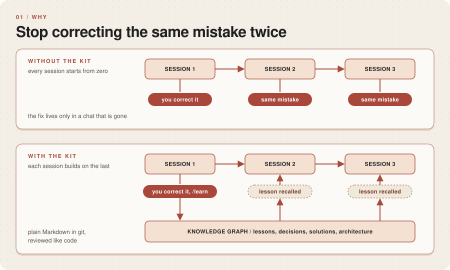
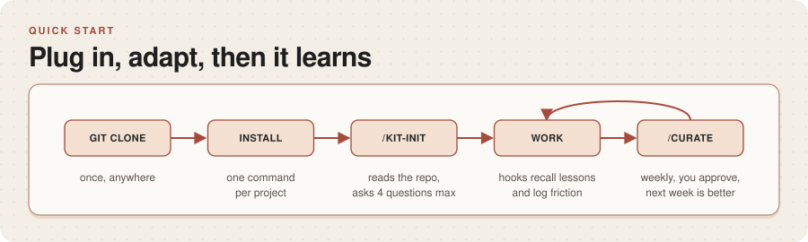
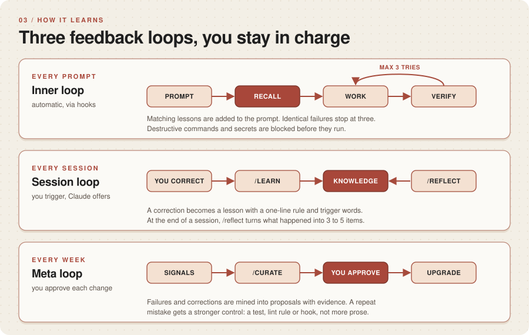
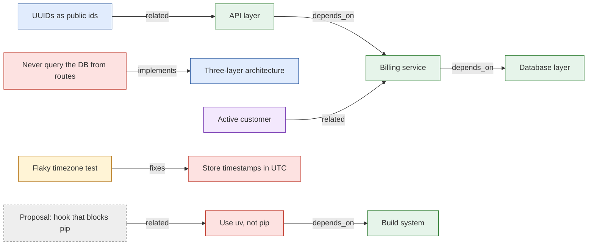

# Claude project kit

[](LICENSE)

A plug-and-play Claude Code setup that adapts to any project and gets better the more you use it.

Drop it into a new or existing repository, run `/kit-init`, and Claude starts every session knowing the project's architecture, its decisions and the mistakes it should not repeat. When you correct Claude, the correction becomes a reviewed lesson in a small knowledge graph, and the next session recalls it on its own. Once a week, `/curate` turns the friction it logged into concrete improvements, and nothing changes until you approve it.

<p align="center"></p>

## Contents

- [Quick start](#quick-start)
- [What you get](#what-you-get)
- [Situations where it helps](#situations-where-it-helps)
- [A week with the kit](#a-week-with-the-kit)
- [How it works](#how-it-works)
- [The knowledge graph](#the-knowledge-graph)
- [Safety model](#safety-model)
- [FAQ](#faq)
- [Credits](#credits)

## Quick start

<p align="center"></p>

Requirements: [Claude Code](https://code.claude.com), git, and Python 3.8 or newer on PATH. No packages to install; everything is standard library.

### 1. Get the kit (once)

```bash
git clone https://github.com/ENIGMA-KUN/claude-project-kit.git
cd claude-project-kit
```

### 2. Install it into a project

Windows (PowerShell):

```powershell
powershell -ExecutionPolicy Bypass -File .\install.ps1 -Target C:\path\to\your-project -Global
```

`-ExecutionPolicy Bypass` only matters if script execution is disabled on your machine, and it applies to this one command.

macOS or Linux:

```bash
./install.sh /path/to/your-project --global
```

`-Global` is optional. It adds a personal `/kit-adopt` command, so later you can open Claude Code in any repository and type `/kit-adopt` instead of running the installer by hand.

### 3. Adapt it to the project

Open Claude Code in the project folder (restart it if it was already open) and run one of:

| Your project | Command |
|--------------|---------|
| Existing codebase | `/kit-init` |
| Empty or nearly empty folder | `/kit-init --new` |
| Kit already installed, or the project changed a lot | `/kit-init --refresh` |

`/kit-init` reads the code first, asks at most four questions about things the code cannot tell it, then writes a short `CLAUDE.md`, seeds the knowledge graph and records your real test and lint commands.

The installer never overwrites your files. If you already have a `CLAUDE.md` or `.claude/settings.json`, the kit's version is parked in `.claude/kit/incoming/` and `/kit-init` merges it with you.

## What you get

| Piece | What it does |
|-------|--------------|
| `/kit-init` | The adaptive init prompt: scans, interviews, writes `CLAUDE.md`, seeds knowledge, verifies commands |
| `knowledge/` | A graph of Markdown nodes (architecture, decisions, lessons, solutions, concepts, procedures) with typed links, sources and review dates |
| Hooks | Recall matching knowledge on each prompt, log corrections and failures, stop the third identical failure, block destructive commands and secrets |
| `/learn` | Turns a correction or a hard-won fix into a node, after you confirm it |
| `/reflect` | End-of-session retro: three to five items worth keeping |
| `/curate` | Weekly meta loop: evidence-backed proposals, constitution check, you approve |
| `/loop-contract` | Goal, budget, stop rule and verification written down before long or risky work |
| `/handoff` | Save state before stopping; resume tomorrow with the claims re-checked |
| `/audit` | Quarterly clean-up of instruction debt and context budget |
| `recall` | Lets Claude search the graph on its own when a task touches known ground |
| `verifier` agent | Fresh-context review that accepts work only on evidence |
| `curator` agent | Mines the friction log and drafts proposals, writing only to the inbox |
| `constitution.md` | Rules the learning loops can never change on their own |
| `kg.py` | The engine: build, validate, search, drift and staleness checks, friction stats, health check |

## Situations where it helps

| Situation | What you run | What you get |
|-----------|--------------|--------------|
| You inherit a large or legacy codebase | `/kit-init` | Architecture nodes for each module, the real commands, and the traps you mention, ready for every later session and for teammates |
| You start a project from an empty folder | `/kit-init --new` | Your stack choices recorded as decisions with reasons, and a tiny `CLAUDE.md` that grows from real corrections instead of guesses |
| Claude keeps making the same mistake (pip instead of uv, wrong test folder, editing generated files) | `/learn` once | A lesson with trigger words; the hook brings it back whenever the trigger shows up. If it still recurs, `/curate` proposes a hook or test instead |
| A bug you fixed months ago comes back | `recall` (automatic) | The old `solutions/` node, with the root cause and the edge cases, shows up when the same error text appears |
| ML or research repo with notebooks and experiments | `/kit-init`, then `/learn` | Concepts for metrics and dataset splits, decisions on evaluation protocol, lessons on things like GPU memory or data leakage |
| A long refactor or migration you want to run with little supervision | `/loop-contract migrate X to Y` | A written contract with allowed files, verification commands and an attempt budget, then an independent verifier verdict with evidence |
| You stop mid-task and come back next week | `/handoff`, later `/handoff resume` | A resume that re-checks what was actually done instead of trusting the old summary |
| Team repository | commit `knowledge/` | Shared, reviewable project memory in pull requests; each person's friction log stays on their machine |
| Non-code work: a paper, docs site, research notes, data analysis | `/kit-init` in that folder | Concepts and decisions for the domain, and `/loop-contract` with a checklist as the verification step |
| You use Claude Code in many repositories | `/kit-adopt` in each | One setup everywhere. Improvements a project discovers for the kit itself go to `FEEDBACK.md`, and re-running the installer upgrades every project |

## A week with the kit

A small FastAPI service, one developer.

- Monday. `/kit-init` finds `uv`, `pytest`, `ruff` and an Alembic folder, asks two questions, writes a 60-line `CLAUDE.md` and seven nodes (four architecture, two decisions, one concept).
- Tuesday. Claude runs `pip install` and breaks the venv. You say "no, we use uv". The prompt hook logs the correction and Claude offers `/learn`; you accept. The lesson gets the rule "Run uv add / uv run; never pip install" and triggers `pip install`, `ModuleNotFoundError`.
- Wednesday. New session. You ask for a new dependency. The hook matches "dependency, install" and puts the uv lesson in context before Claude acts.
- Thursday. A test fails three times in a row with the same import error. The failure hook tells Claude the loop budget is spent; it stops retrying, finds the circular import, and you `/learn` the fix as a solution node.
- Friday. `/reflect` suggests two more items; you keep one.
- The next Monday. The session-start note says the meta loop is due. `/curate` shows that the uv lesson was injected twice and the failure did not recur, and that the circular-import pattern appeared in two sessions. It proposes an import-linter rule in CI. You approve; it adds the rule and runs the check to show it passes.

## How it works

<p align="center"></p>

The kit follows the ideas in loop and graph engineering: start with the smallest structure that works, give every loop a stop rule and a budget, make routes explicit when there are branches, and close the loop by feeding what was learned back into the next plan.

<p align="center"></p>

Three design choices keep it from turning into a pile of rules:

- Facts are retrieved, not always loaded. Lessons and decisions live in the graph and reach the context only when a prompt matches them, so `CLAUDE.md` can stay under 150 lines.
- The strongest control wins. A mistake that recurs after its lesson was recalled gets a test, lint rule or hook, because prose is the one control that has to be remembered.
- Nothing promotes itself. Proposals carry evidence and wait for you. A proposal seen three times must be decided, so the loop cannot stay open.

Hook events, retrieval settings, signal format and the proposal lifecycle are in [docs/how-it-works.md](docs/how-it-works.md).

## The knowledge graph

One concept per Markdown file. The path is the id, frontmatter carries the type, status, source and links:

```markdown
---
type: lesson
title: "Use uv, not pip"
description: "pip installs into the global interpreter here; uv manages the project venv."
status: active
source: "correction, session 2026-11-18"
created: 2026-11-18
review_by: 2027-02-16
rule: "Run uv add / uv run; never pip install."
trigger: [pip install, ModuleNotFoundError, site-packages]
paths: [pyproject.toml]
relations:
  depends_on: [architecture/build-system]
---
```

When a prompt matches, Claude sees one line per node, not the whole file:

```
[project-kit]
Project knowledge that may apply (read the file before relying on details):
- [lesson] Use uv, not pip: Run uv add / uv run; never pip install. (knowledge/lessons/use-uv-not-pip.md)
```

A filled-in example lives in [examples/sample-project](examples/sample-project). Its graph:



Everyday commands, from the project root:

```bash
python .claude/kit/kg.py query "error text or module name"
python .claude/kit/kg.py show lessons/use-uv-not-pip
python .claude/kit/kg.py validate        # schema, links, drift, secrets
python .claude/kit/kg.py stale           # past review date or code moved
python .claude/kit/kg.py signals         # friction and lesson effectiveness
python .claude/kit/kg.py doctor          # health and context maturity level
python .claude/kit/kg.py mermaid         # draw your own graph
```

Full schema: [template/knowledge/_schema.md](template/knowledge/_schema.md).

## Safety model

- Destructive commands: recursive deletes of root or home folders, force pushes to main or master and disk-level commands are denied; `git reset --hard`, `git clean`, destructive SQL, publishing and anything touching credential files ask first.
- Secrets: writes into `knowledge/`, `CLAUDE.md`, `.claude/rules`, `.claude/skills` and `.claude/agents` are scanned and denied on a match. The scan reports the kind of secret, never the value.
- Privacy: the friction log stays on your machine (`.claude/kit/signals/`, gitignored), is redacted before writing, and the hooks make no network calls.
- Untrusted input: facts from web pages, issues or other tools enter the graph only as candidates, which are never served to sessions until approved.
- Approval: the constitution says nothing reaches `CLAUDE.md`, rules, skills, hooks or settings without your yes, and a hook asks before anything edits the constitution.
- Failure mode: hooks fail open. A kit bug logs to `.claude/kit/state/hook-errors.log` and never blocks your session.

## FAQ

### Does it cost many tokens?

The session-start note is about ten lines. Per prompt, at most three one-line pointers are added, and only when nodes match. `kg.py doctor` reports the always-on budget.

### Does it work with an existing CLAUDE.md or AGENTS.md?

Yes. `/kit-init` backs up and merges an existing `CLAUDE.md`, and imports a maintained `AGENTS.md` with `@AGENTS.md` instead of copying it.

### Windows?

Yes. It was built and tested on Windows 11 with Git Bash, which is what Claude Code uses to run hooks there. The test suite passes on Python 3.8, 3.10 and 3.12. The hooks and installer are plain Python, so macOS and Linux should behave the same; reports are welcome.

### Other agents (Cursor, Codex, Gemini CLI)?

The knowledge graph is plain Markdown that any agent can read, and [INIT_PROMPT.md](INIT_PROMPT.md) has paste-in prompts for agents without skills. The hooks are Claude Code only.

### How do I know it actually helps?

`kg.py signals` shows, per lesson, how often it was recalled and whether its trigger came back afterwards. A lesson that is recalled but keeps recurring needs a stronger control; one that is never recalled may be dead weight. `/audit` adds canary prompts you can run before and after changes.

### A lesson is wrong. What now?

Tell Claude; it will offer to update it. Nodes are never deleted, only marked `superseded` or `archived`, so the history stays in git.

### How do I upgrade or remove it?

`git pull` in the kit folder, re-run the installer on the project, then `/kit-init --refresh`. To remove: delete `.claude/hooks/kit_hook.py`, `.claude/kit/`, the kit skills and agents, the `kit_hook.py` entries in `.claude/settings.json` and the `project-kit` block in `.gitignore`. `knowledge/` is plain Markdown; keep it if you like.

## Repository layout

```
install.ps1, install.sh   launchers that find Python and call install.py
install.py                the installer (never overwrites your files)
INIT_PROMPT.md            the init prompt for manual use or other agents
FEEDBACK.md               improvements to the kit collected from projects
docs/                     how-it-works reference and diagrams
examples/sample-project/  a filled-in knowledge graph to explore
tests/smoke_test.py       end-to-end test of the installer, engine and every hook
template/                 what gets copied into a project
  CLAUDE.md
  knowledge/              schema, log, one starter decision
  .claude/settings.json   hook registration and deny rules
  .claude/constitution.md
  .claude/hooks/kit_hook.py
  .claude/kit/            kg.py engine, config.json, contracts/
  .claude/rules/          knowledge-authoring.md (loads only for knowledge/)
  .claude/skills/         kit-init, learn, reflect, curate, recall, handoff, loop-contract, audit
  .claude/agents/         verifier, curator
```

## Contributing

Issues and pull requests are welcome. Run `python tests/smoke_test.py` before sending a change; it builds a throwaway project, installs the kit and exercises the engine and every hook event. If you used the kit on a kind of project it handled badly, an issue with the `FEEDBACK.md` note `/kit-init` wrote is the most useful report.

## Credits

The design draws on Florian Bruniaux's [Claude Code Ultimate Guide](https://github.com/FlorianBruniaux/claude-code-ultimate-guide), in particular:

| Kit piece | Guide chapter |
|-----------|---------------|
| `/loop-contract`, budgets, verifier, terminal states | [Loop and graph engineering](https://github.com/FlorianBruniaux/claude-code-ultimate-guide/blob/main/guide/core/loop-graph-engineering.md) |
| Inner, session and meta loops; creator and verifier separation | [Agent harness engineering](https://github.com/FlorianBruniaux/claude-code-ultimate-guide/blob/main/guide/core/agent-harness.md) |
| Knowledge graph, candidates, provenance, hook-driven capture, BM25 for lexical queries | [Memory systems](https://github.com/FlorianBruniaux/claude-code-ultimate-guide/blob/main/guide/core/memory-systems.md) |
| Lean `CLAUDE.md`, path-scoped rules, update loop, curation, ejection, constitution, maturity levels | [Context engineering](https://github.com/FlorianBruniaux/claude-code-ultimate-guide/blob/main/guide/core/context-engineering.md) |
| Hook events and outputs | [Hooks events reference](https://github.com/FlorianBruniaux/claude-code-ultimate-guide/blob/main/guide/core/hooks-events-reference.md) |

The guide is published under CC BY-SA 4.0. This kit is original code and text that applies its ideas, released under the MIT license.
